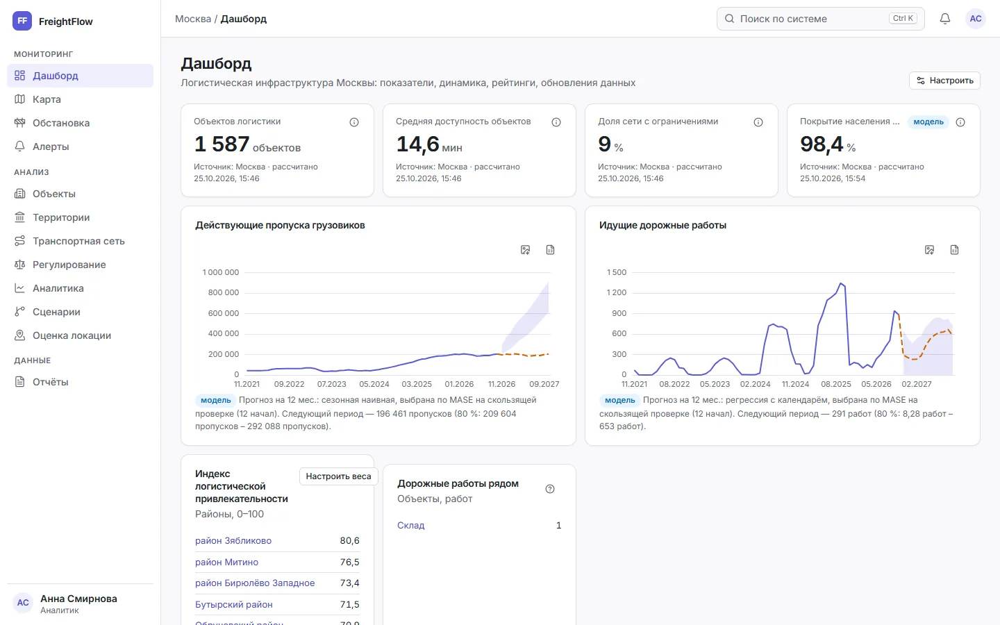
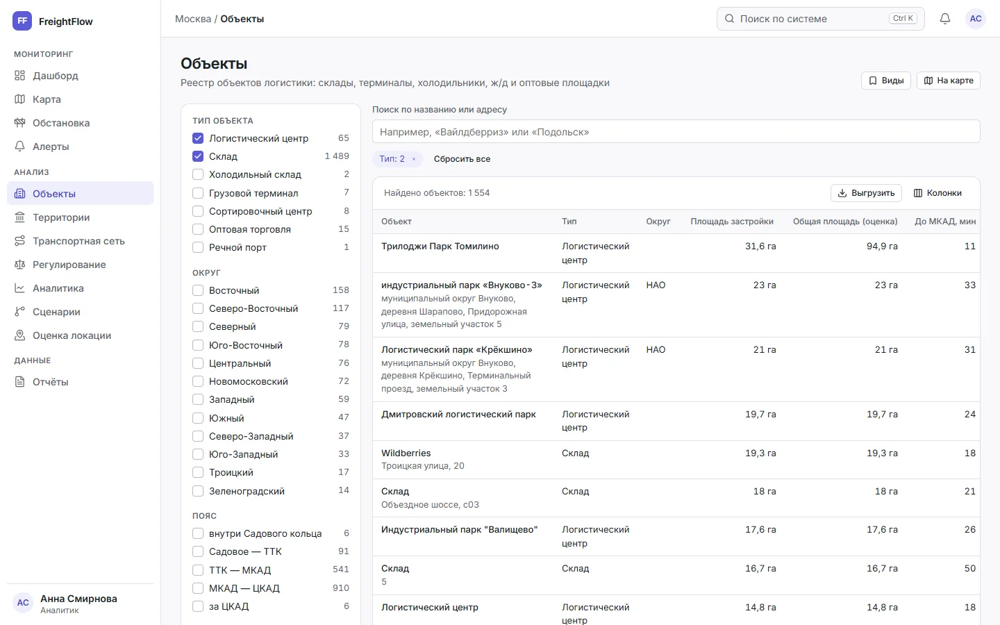
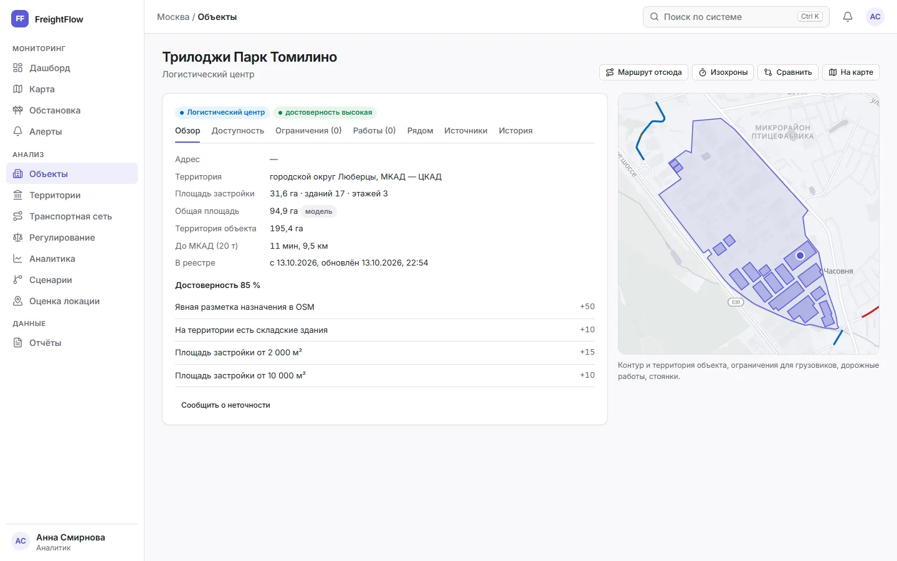
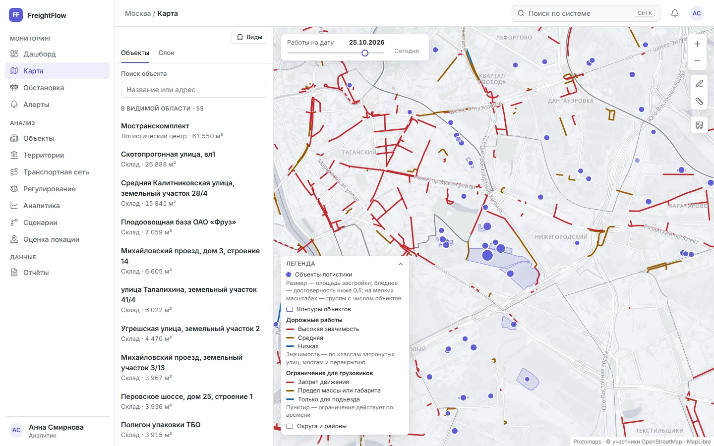
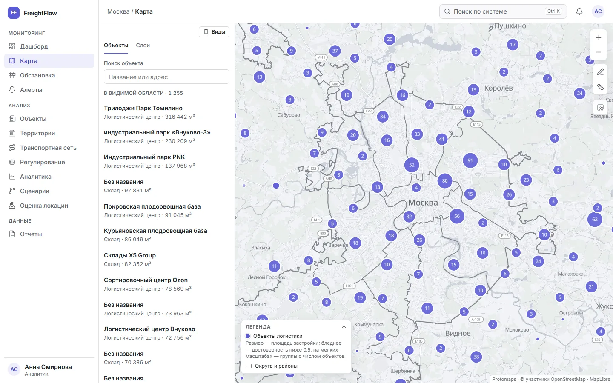
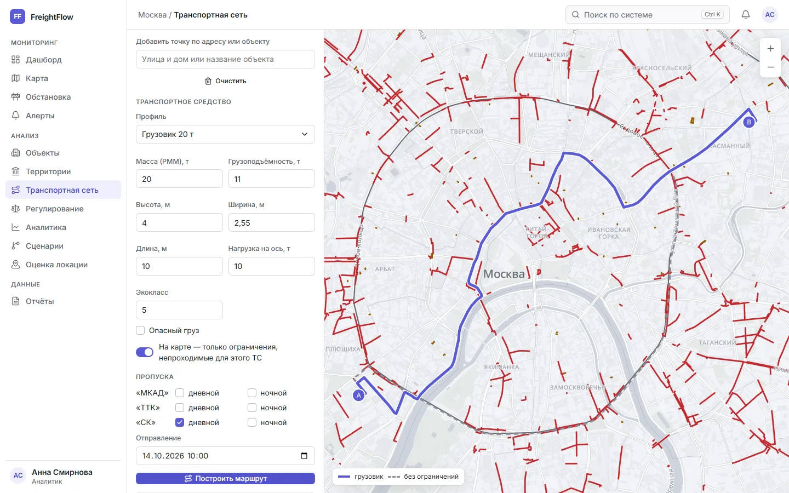
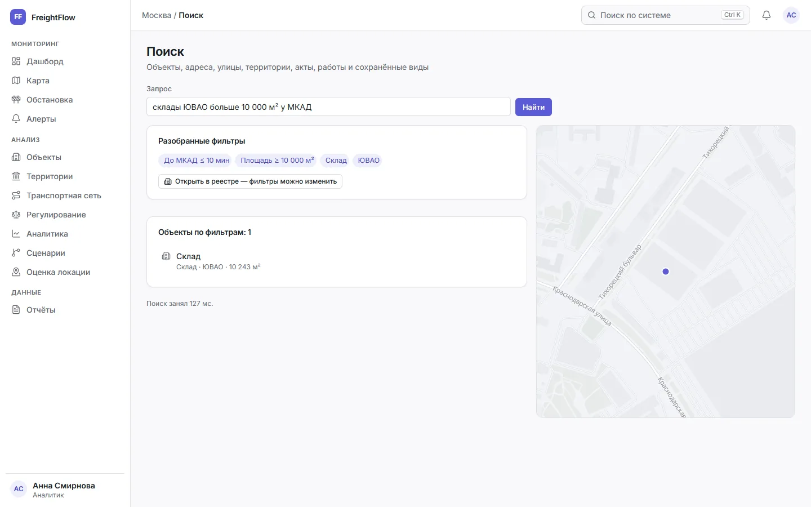
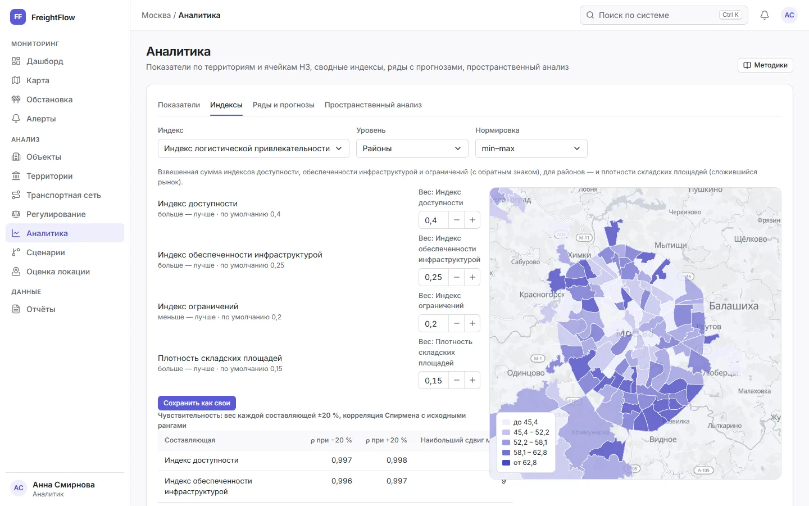
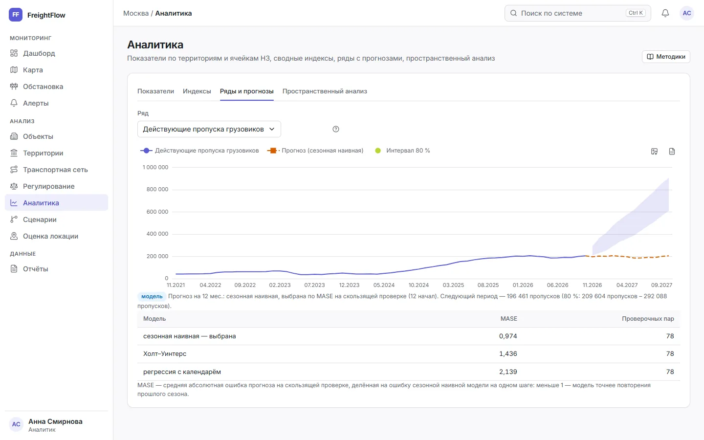
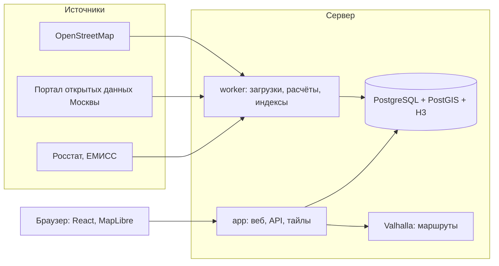

# FreightFlow

[](https://github.com/ht2473/FreightFlow_v2/actions/workflows/ci.yml)
[](LICENSE)

Информационная система мониторинга и анализа логистической инфраструктуры Москвы на открытых
данных: реестр складов, логистических центров и терминалов, дорожная сеть с ограничениями для
грузового транспорта, маршруты грузовиков с учётом зон и пропусков, показатели территорий,
сводные индексы, прогнозы и единый поиск.



## Возможности

**Реестр объектов.** Около 1 600 объектов логистики Москвы и ближайшего Подмосковья из
OpenStreetMap, дополненных адресным реестром и разрешениями на ввод. Фасеты, фильтры (тип,
округ, район, пояс, площадь, время до МКАД, ограничения рядом), выгрузка в CSV, XLSX и GeoJSON,
карточка объекта с доступностью, ограничениями, дорожными работами и инфраструктурой рядом,
оценка достоверности записи с причинами, правки редактора поверх источников и история изменений.

| | |
|---|---|
|  |  |

**Карта.** Векторная подложка и слои данных: объекты (на мелких масштабах — кластеры),
ограничения для грузовиков из OSM и реестра дорожных знаков, дорожные работы на выбранную дату,
зоны ограничения движения, стоянки и АЗС, ячейки H3 с показателями. Выделение области со
сводкой, измерение, сохранённые виды, изображение карты с легендой и источниками.

| | |
|---|---|
|  |  |

**Маршруты и сеть.** Маршрут грузовика по графу Valhalla с ограничениями из дорожных знаков и
политикой зон МКАД, ТТК и Садового кольца (пропуска, экокласс, время суток) — с объяснением
обходов и сравнением с маршрутом без ограничений; изохроны, матрица времени, доступность каждого
объекта до МКАД, ТТК, центра и ж/д пунктов; сетевой анализ — значимость участков, узкие места по
габаритам, критичные мосты.



**Поиск.** Палитра Ctrl K и страница результатов: объекты, адреса, улицы, районы, правовые акты,
дорожные работы, сохранённые виды. Запрос вида «склады ЮВАО больше 10 000 м² у МКАД» разбирается
в фильтры реестра; поиск устойчив к опечаткам; прямой и обратный геокодер. Качество измерено на
наборе из 178 запросов (nDCG@10 0,98).



**Аналитика.** Каталог показателей с методиками (объекты, районы, округа, ячейки H3, участки
сети, город), картограммы и рейтинги, сводные индексы доступности, обеспеченности
инфраструктурой, ограничений и логистической привлекательности с настройкой весов и анализом
чувствительности, ряды с прогнозами (сезонная наивная модель, Холт–Уинтерс, регрессия с
производственным календарём; выбор по MASE на скользящей проверке), горячие точки Gi* и кластеры
DBSCAN.

| | |
|---|---|
|  |  |

**Регулирование.** Правила зон ограничения движения грузового транспорта с основаниями в
правовых актах, грузовой каркас, статистика пропусков и специальных разрешений.

## Архитектура



- **app** — один бинарник на Go: страницы входа (templ), API по спецификации OpenAPI (ogen),
  векторные тайлы из PostGIS, встроенный интерфейс.
- **worker** — очередь задач River: загрузки источников с проверками качества и снимками,
  пересчёт показателей, поиска и доступности по изменениям данных.
- **db** — PostgreSQL 18 с PostGIS, H3 и pg_trgm: хранение, пространственные расчёты, поиск.
- **routing** — Valhalla с графом, на который наложены ограничения из дорожных знаков.

## Стек

| Часть | Технологии |
|---|---|
| Сервер | Go 1.27, pgx, ogen (OpenAPI), templ, River, goose, gonum, excelize |
| Данные | PostgreSQL 18, PostGIS 3.6, H3, pg_trgm; osm2pgsql, osmium, GDAL |
| Маршруты | Valhalla 3.9 |
| Интерфейс | React 19, TypeScript, Vite, TanStack Router и Query, React Aria, MapLibre GL, ECharts, terra-draw |
| Проверки | go test (интеграционные — на настоящей БД), golangci-lint, govulncheck, Vitest, Biome, Playwright с axe (WCAG 2.2 AA, обе темы) |

## Источники данных

| Источник | Лицензия |
|---|---|
| © участники [OpenStreetMap](https://www.openstreetmap.org/copyright), выгрузка Geofabrik | ODbL 1.0 |
| Подложка [Protomaps](https://protomaps.com) (OpenStreetMap, Natural Earth) | ODbL 1.0 |
| [Портал открытых данных Правительства Москвы](https://data.mos.ru) — около 40 наборов: дорожные знаки и работы, адресный реестр, разрешения на ввод, стоянки и АЗС, зоны охраны, пропуска, спецразрешения и др. | CC BY 4.0 |
| Департамент транспорта Москвы, Единый транспортный портал — грузовой каркас | официальная информация органа власти, с указанием источника |
| Росстат, база показателей муниципальных образований — население | официальная статистика, с указанием источника |
| ЕМИСС (fedstat.ru) — перевозки грузов автомобильным транспортом | официальная статистика, с указанием источника |
| «Карта ДТП» ([dtp-stat.ru](https://dtp-stat.ru)) по данным ГИБДД | с активной ссылкой на источник |
| Производственный календарь ([isdayoff.ru](https://isdayoff.ru)) | сведения из официальных актов |

Атрибуция показывается на карте, в карточках, отчётах и каждой выгрузке.

## Запуск для разработки

Требуются Go 1.27, Node.js 24, Docker и [Task](https://taskfile.dev) 3.

```sh
cp .env.example .env    # заполнить ключи
task dev                # БД и почта в Docker, сервер (8080) и Vite — http://localhost:5173
```

Загрузка данных — в контейнере `worker` с инструментами обработки, данные — в `var/`:

```sh
task etl:image              # образ worker
task etl:run SOURCE=osm     # OpenStreetMap: территории, объекты, сеть, ограничения
task etl:run SOURCE=basemap # подложка карты
task etl:up                 # worker в фоне: выполняет запуски по расписанию
task etl:list               # источники и последние запуски
```

Команды приложения: `freightflow search reindex | eval`, `freightflow analytics recompute |
index | forecast`, `freightflow routing accessibility | analyze`.

Проверка перед коммитом — `task check` (линтеры, тесты Go и интерфейса, сборка, уязвимости);
сквозные тесты — `task e2e` на запущенном стенде.

## Состояние

Готовы реестр, карта, маршрутизация и сетевой анализ, поиск, аналитика и показатели. В работе —
сценарии «что если» и оценка локации (МАИ + TOPSIS), затем мониторинг и алерты, отчёты и
публичный API, выпуск и развёртывание.

## Лицензия

Код — [MIT](LICENSE). Данные принадлежат их правообладателям и используются на условиях
лицензий, указанных выше.
